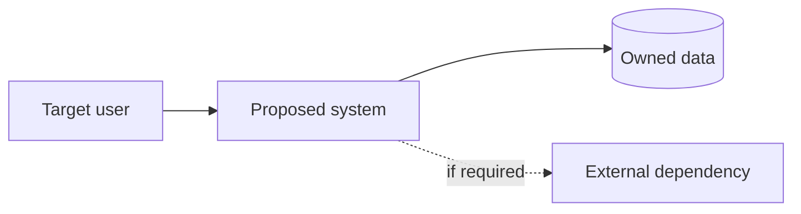

# System Architecture

**Status:** DRAFT  
**Architect:** [ISI]  
**Related PRD version:** [ISI]  
**Related ADRs:** [Links]

## 1. Design drivers
| Driver | Requirement ref | Consequence for design |
|---|---|---|
| [ISI] | [FR/NFR] | [ISI] |

## 2. Alternatives considered
| Option | Strengths | Costs/risks | Disqualifying constraints | Decision |
|---|---|---|---|---|
| A — minimal viable architecture | [ISI] | [ISI] | [ISI] | Pending |
| B — alternative if warranted | [ISI] | [ISI] | [ISI] | Pending |

## 3. C4 context diagram (Mermaid)

Replace placeholders before approval.

## 4. Container and component boundaries
| Component | Responsibility | Owns state? | Public contract | Failure mode |
|---|---|---|---|---|
| [ISI] | [ISI] | [Yes/No] | [ISI] | [ISI] |

## 5. Core flows and trust boundaries
- Flow A: `[actor] → [auth] → [domain] → [storage] → [response]`.
- Trust boundaries: [internal, public, provider, ops].
- Authorizations per flow: [ISI].
- Error paths: timeout, retries, idempotency, eventual consistency [if relevant].

## 6. Deployment architecture
- Environment: dev, staging, prod [as required].
- On-prem/cloud/hybrid decision: [ISI].
- Networking: ingress/egress, segmentation, TLS: [ISI].
- Secrets: vault / secret provider [TBD].
- Backup/recovery: [ISI].
- Scaling and availability: [ISI].

## 7. Persistence & integrations
- Entities and relationships: `DATA_MODEL.md`.
- Sync/async decision rationale: [ISI].
- Migration and rollback strategy: [ISI].

## 8. Security / privacy / observability
- Threat model: `SECURITY_THREAT_MODEL.md`.
- Logs/traces/metrics ownership: [ISI].
- Data encryption and retention: [ISI].

## 9. Decision history
Capture non-trivial decisions as `docs/adr/ADR-000N-*.md` with alternatives and reasoning. Avoid a tech stack decision without explicit constraints.

## 10. Risks and feasibility spikes
| Assumption | How to verify it cheaply | Stop condition | Owner |
|---|---|---|---|
| [ISI] | [prototype/test/doc] | [ISI] | [ISI] |

## Approval
- Reviewer: [ISI]
- Recorded decision: [link to DECISION_LOG]
