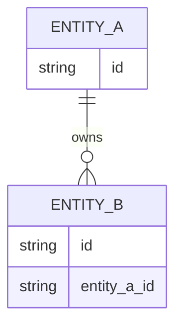

# Domain and Data Model

**Status:** DRAFT  
**Owner:** [FILL]  
**Related architecture:** `ARCHITECTURE.md`

## Domain glossary
| Domain term | Definition | Invariant | Owner |
|---|---|---|---|
| [FILL] | [FILL] | [FILL] | [FILL] |

## Entities and relationships

> Placeholder illustration — replace with real entities before approval.

## Data ownership
| Data category | Source of truth | Writer | Reader | Classification |
|---|---|---|---|---|
| [FILL] | [FILL] | [FILL] | [FILL] | [FILL] |

## Interface contracts
- API/command/event examples: [Path or schema].
- Validation and typed errors: [FILL].
- Idempotency key/duplicate handling: [FILL].
- API evolution and compatibility: [FILL].

## Storage lifecycle
- Retention/deletion: [FILL].
- Index and access pattern assumptions: [FILL].
- Migration & rollback: [FILL].
- Personal data handling: [FILL].
